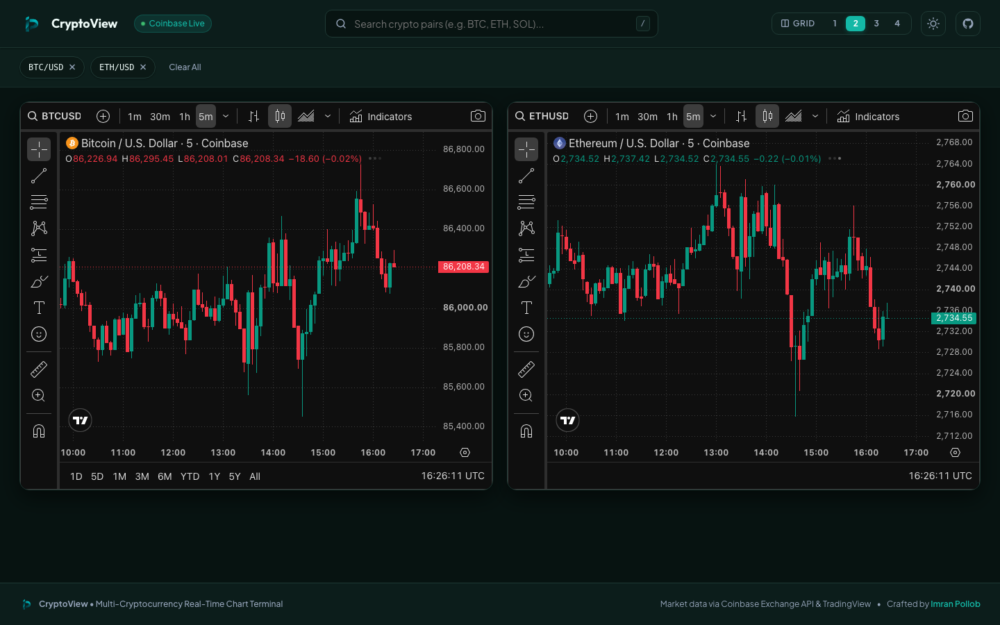

# CryptoView

A fast, clean way to watch multiple cryptocurrency charts side-by-side without the clutter. 

👉 **[Live Demo](https://imranpollob.github.io/crypto-chart-viewer/)**



---

## Why I Built This

Most crypto platforms lock multi-chart layouts behind subscriptions or overload you with noisy feeds. CryptoView is built to be simple, snappy, and focused: pick your coins, choose your layout, and monitor live price action in real time.

## Highlights

- **Flexible Grid**: Pick 1, 2, 3, or 4 charts per row on desktop. Automatically stacks into a clean single column on mobile.
- **Live TradingView Charts**: Real-time candlesticks with default 5-minute intervals and technical indicators.
- **Coinbase Market Data**: Fast pair search powered by Coinbase Exchange API with smart matching and keyboard navigation (`/` to search).
- **Theme Switcher**: Dark and light modes that sync with TradingView's chart theme.
- **Zero Build Step**: Pure HTML5, modern CSS, and vanilla ES modules. No bundlers or heavy dependencies required.

## Getting Started

Because browsers restrict loading local JSON files (`tokens.json`) directly from `file://`, run a local static server:

```bash
# 1. Clone the repo
git clone https://github.com/imranpollob/crypto-chart-viewer.git
cd crypto-chart-viewer

# 2. Start a local server
python3 -m http.server 8000
# or: npx serve
```

Then visit `http://localhost:8000` in your browser.

## Keeping Token Lists Fresh

To update the cached list of supported Coinbase USD pairs:

```bash
node generate_tokens.js
```

---

Made by [Imran Pollob](https://github.com/imranpollob).
